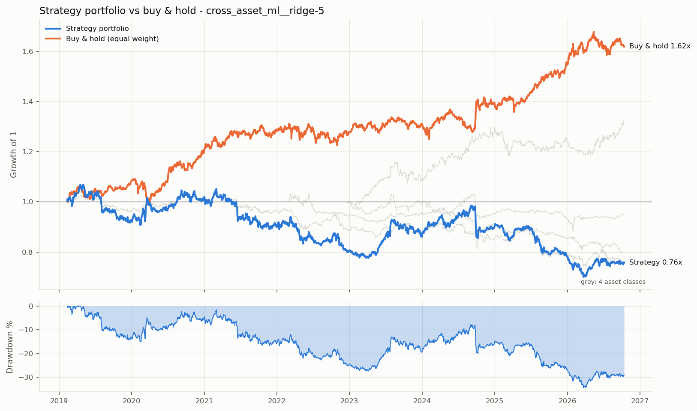
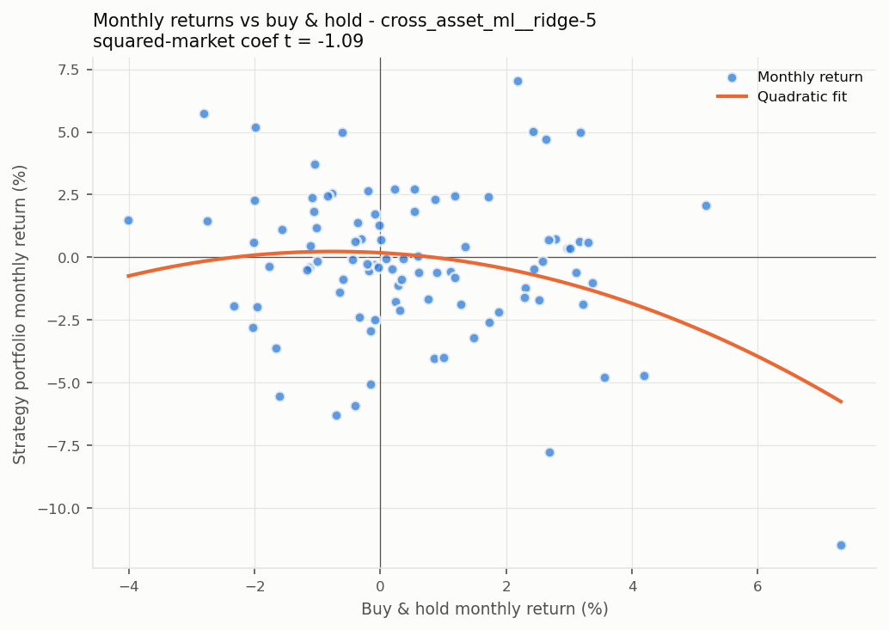

# 跨资产组合回测: 机器学习信号

> 生成时间: 2026-10-14 09:36 | 配置: `strategies/ml_signal/configs/cross_asset_ml.toml`  
> **信号**: `ridge:5,0` | **过滤**: `none` | 周期: 1d | 起始: 2015-01-01  
> 组合: 各类别内等权, 再类别间等权 | 组合缩放到 10% 目标波动  
> 执行: 收盘价成交, 1% 风险/ATR 定仓位, 逐根盯市, 止损跳空按开盘价, 信号用复权价、盈亏用真实价格

| 市场 | 手续费 (单边) | 印花税 | 滑点 | 做空 | 每品种本金 |
|---|---:|---:|---:|---|---:|
| future | 1.0‱ | 0‱ | 1 跳 (最小变动价位) | 可以 | 10,000,000 |
| fx | 0.2‱ | 0‱ | 1.0‱ | 可以 | 1,000,000 |

按手收手续费的品种: T, TF, TL, TS; 其余期货按费率。

---

## 一、各品种表现

| 类别 | 品种 | 周期 | 起始 | 交易 | 年化% | 年化波动% | 夏普 | PF | 最大回撤% | Calmar | 持仓占比% |
|---|---|---|---|---:|---:|---:|---:|---:|---:|---:|---:|
| 股指 | IF | 1d | 2022-12-13 | 80 | -6.8 | 13.8 | -0.44 | 0.62 | -29.3 | -0.23 | 100 |
| 股指 | IH | 1d | 2022-12-13 | 69 | -4.1 | 13.1 | -0.25 | 0.76 | -27.9 | -0.15 | 100 |
| 股指 | IC | 1d | 2022-12-13 | 53 | -11.9 | 12.7 | -0.94 | 0.42 | -37.9 | -0.32 | 100 |
| 股指 | IM | 1d | 2026-09-16 | 3 | -27.6 | 6.7 | -5.11 | 0.04 | -2.6 | -10.52 | 100 |
| 国债 | T | 1d | 2023-01-04 | 93 | +3.6 | 10.5 | 0.39 | 1.27 | -12.3 | 0.30 | 100 |
| 国债 | TF | 1d | 2023-02-03 | 117 | +13.6 | 10.3 | 1.28 | 2.00 | -9.3 | 1.46 | 100 |
| 国债 | TS | 1d | 2023-03-15 | 85 | +7.1 | 10.3 | 0.72 | 1.51 | -14.7 | 0.49 | 100 |
| 商品 | RB | 1d | 2022-07-11 | 81 | +2.4 | 10.6 | 0.27 | 1.22 | -12.6 | 0.19 | 100 |
| 商品 | I | 1d | 2022-06-30 | 117 | +0.6 | 9.7 | 0.11 | 1.03 | -10.1 | 0.06 | 100 |
| 商品 | CU | 1d | 2022-07-11 | 89 | -3.8 | 12.4 | -0.25 | 0.78 | -30.4 | -0.12 | 100 |
| 商品 | AL | 1d | 2022-07-11 | 110 | +0.8 | 11.7 | 0.12 | 1.05 | -18.8 | 0.04 | 100 |
| 商品 | AU | 1d | 2022-08-11 | 79 | -0.6 | 13.1 | 0.02 | 0.97 | -37.6 | -0.01 | 100 |
| 商品 | AG | 1d | 2022-07-11 | 81 | +2.2 | 29.2 | 0.21 | 1.09 | -68.9 | 0.03 | 100 |
| 商品 | SC | 1d | 2022-07-01 | 81 | -0.9 | 13.2 | -0.00 | 0.93 | -23.3 | -0.04 | 100 |
| 商品 | TA | 1d | 2022-07-11 | 107 | -7.2 | 11.9 | -0.56 | 0.61 | -31.1 | -0.23 | 100 |
| 商品 | MA | 1d | 2022-07-13 | 80 | -1.0 | 10.4 | -0.04 | 0.93 | -19.6 | -0.05 | 100 |
| 商品 | M | 1d | 2022-07-11 | 97 | -3.4 | 10.5 | -0.28 | 0.82 | -27.1 | -0.13 | 100 |
| 商品 | Y | 1d | 2022-07-11 | 95 | -3.3 | 9.8 | -0.29 | 0.75 | -18.6 | -0.18 | 100 |
| 商品 | CF | 1d | 2022-07-11 | 102 | +3.1 | 10.4 | 0.35 | 1.19 | -13.7 | 0.23 | 100 |
| 商品 | SR | 1d | 2022-03-02 | 130 | -5.0 | 10.5 | -0.43 | 0.70 | -33.3 | -0.15 | 100 |
| 汇率 | USDCNH | 1d | 2018-11-20 | 176 | -8.4 | 11.7 | -0.69 | 0.55 | -55.0 | -0.15 | 100 |
| 汇率 | EURUSD | 1d | 2018-11-15 | 216 | -8.1 | 10.5 | -0.75 | 0.61 | -51.4 | -0.16 | 100 |
| 汇率 | USDJPY | 1d | 2018-11-15 | 198 | +0.0 | 12.0 | 0.06 | 1.00 | -34.0 | 0.00 | 100 |
| 汇率 | AUDUSD | 1d | 2018-11-15 | 221 | -0.7 | 10.8 | -0.01 | 0.96 | -23.4 | -0.03 | 100 |
| 汇率 | GBPUSD | 1d | 2018-11-15 | 204 | -0.5 | 10.6 | 0.00 | 0.97 | -19.1 | -0.03 | 100 |

---

## 三、各资产类别 (类别内等权)

|  | 起始 | 年化收益% | 年化波动% | 夏普 | Sortino | 最大回撤% | Calmar | 成员数 |
|---|---|---:|---:|---:|---:|---:|---:|---:|
| 股指 | 2022-12-14 | -7.0 | 10.6 | -0.63 | -0.65 | -28.2 | -0.25 | 4 |
| 国债 | 2023-01-05 | +7.8 | 7.9 | 0.99 | 1.36 | -8.9 | 0.88 | 3 |
| 商品 | 2022-03-03 | -1.1 | 4.8 | -0.21 | -0.28 | -15.0 | -0.07 | 13 |
| 汇率 | 2018-11-16 | -3.2 | 5.7 | -0.54 | -0.71 | -23.0 | -0.14 | 5 |
| 组合 (全样本) | 2018-11-16 | -1.9 | 4.6 | -0.38 | -0.51 | -16.7 | -0.11 | 25 |
| 组合 (全部类别到齐后) | 2023-01-05 | -0.4 | 3.7 | -0.10 | -0.13 | -9.9 | -0.04 | 25 |

类别开始时间不同时, 早期的组合只由已有数据的类别构成, "全部类别到齐后"才是完整的跨资产组合。

类别之间的相关性 (策略日收益):

|  | 股指 | 国债 | 商品 | 汇率 |
|---|---:|---:|---:|---:|
| 股指 | 1.00 | 0.06 | -0.15 | -0.01 |
| 国债 | 0.06 | 1.00 | -0.04 | 0.01 |
| 商品 | -0.15 | -0.04 | 1.00 | 0.02 |
| 汇率 | -0.01 | 0.01 | 0.02 | 1.00 |

品种两两相关性平均: **类内 0.06**, **跨类 -0.01** (对照 TSMOM 论文 Table 4)。

---

## 四、组合目标波动率 10%

|  | 起始 | 年化收益% | 年化波动% | 夏普 | Sortino | 最大回撤% | Calmar | 平均杠杆 | 最高杠杆 |
|---|---|---:|---:|---:|---:|---:|---:|---:|---:|
| 原始 | 2018-11-16 | -1.9 | 4.6 | -0.38 | -0.51 | -16.7 | -0.11 | 1.0 | 1.0 |
| 缩放后 | 2019-02-12 | -3.5 | 10.2 | -0.30 | -0.41 | -34.5 | -0.10 | 2.4 | 4.0 |

杠杆 = 目标波动 / 过去波动 (EWMA, 质心 60 天, 上限 10 倍), 只用过去数据。夏普基本不变, 收益和回撤同比例放大。以下各节使用缩放后的组合。

---

## 五、压力时期

| 时期 | 区间 | 策略组合% | 买入持有% | 当时有数据的类别 |
|---|---|---:|---:|---|
| 2020 疫情冲击 | 2020-01-20 ~ 2020-03-23 | +7.0 | -9.0 | 汇率 |
| 2022 全球加息 | 2022-01-01 ~ 2022-10-31 | -4.1 | -4.9 | 商品, 汇率 |
| 2022 LUNA 崩盘 | 2022-05-05 ~ 2022-06-18 | +0.4 | +1.7 | 商品, 汇率 |
| 2022 FTX 破产 | 2022-11-06 ~ 2022-11-21 | -2.4 | +0.3 | 商品, 汇率 |
| 2024 年初小盘股下跌 | 2024-01-02 ~ 2024-02-05 | +6.6 | -4.6 | 股指, 国债, 商品, 汇率 |
| 2024-08 日元套息平仓 | 2024-07-31 ~ 2024-08-07 | -1.4 | -0.6 | 股指, 国债, 商品, 汇率 |
| 2025-04 关税冲击 | 2025-04-02 ~ 2025-04-09 | +2.9 | -3.1 | 股指, 国债, 商品, 汇率 |

日期为大致区间, 用来观察趋势策略在危机中的表现。

---

## 六、组合表现与风险特征

#### 组合表现 (ridge:5,0 | none; 4 个类别、25 个品种×周期, 2019-02-12 ~ 2026-10-13)

| 指标 | 策略组合 | 基准: 等权买入持有 |
|---|---:|---:|
| 年化收益 % | -3.5 | +6.5 |
| 年化波动 % | 10.2 | 7.1 |
| 夏普 | -0.30 | 0.92 |
| Sortino | -0.41 | 1.22 |
| 最大回撤 % | -34.5 | -9.4 |
| Calmar | -0.10 | 0.69 |

跨类别品种两两相关性平均: -0.01  (越低, 分散化降波动的效果越好)

| 年份 | 策略组合 | 等权持有 |
|---|---:|---:|
| 2019 | -7.1% | +8.3% |
| 2020 | +9.4% | +11.6% |
| 2021 | -11.6% | +6.6% |
| 2022 | -10.2% | -0.7% |
| 2023 | +6.8% | +2.5% |
| 2024 | +5.4% | +5.8% |
| 2025 | -14.1% | +11.5% |
| 2026 | -2.9% | +4.7% |

#### 风险特征 (月度回归, 括号内为 Newey-West t 值)

| 回归 | α (月) | 基准收益 | 基准收益² | 基准波动率 | 高波动哑变量 | R² |
|---|---:|---:|---:|---:|---:|---:|
| CAPM | -0.07% (-0.26) | -0.334 (-1.29) | | | | 0.05 |
| Smile | | -0.137 (-0.60) | -9.193 (-1.09) | | | 0.08 |
| 波动率状态 | | | | 0.125 (0.41) | -1.05% (-0.64) | 0.01 |

样本 93 个月。读法:
- **CAPM α**: 月均 -0.07% (年化约 -0.9%), t = -0.26。不显著, 收益大部分可由被动做多解释。
- **Smile**: 基准收益平方项 t = -1.09。不显著: 没有明显的"危机阿尔法"。
- **波动率状态**: 基准波动率 t = 0.41, 高波动哑变量 t = -0.64。与市场波动率状态关系不显著 (这也说明按波动率择时的 GARCH 过滤器改善空间有限)。
- CAPM 的截距是 α (基准是可交易的等权持有组合); Smile 和波动率回归的截距没有 α 含义, 不报告。
- 高波动阈值用全样本 80% 分位数, 是描述性分析, 不能直接当交易规则。

