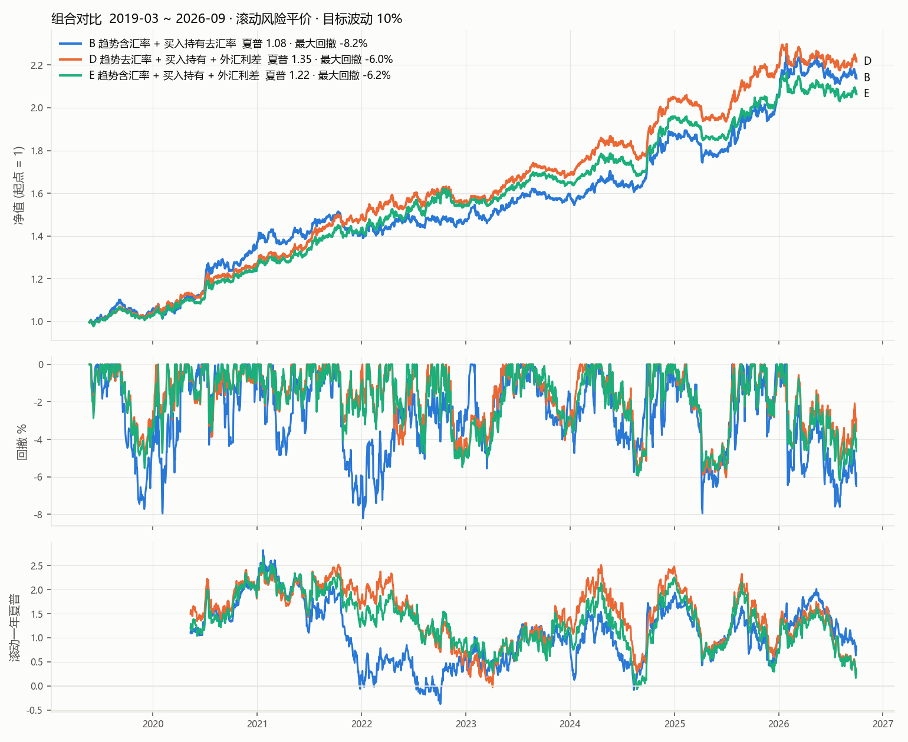

# 趋势 + 买入持有 (+ 外汇利差) 组合

- 趋势: `donchian:60,20`, 缩放到 10% 波动; 买入持有: 同样的品种和类别权重; 外汇利差: `fx_carry.py` (规则事先固定)
- 组合: 滚动风险平价 (EWMA 质心 250 天, 滞后一天), 整体缩放到 10%, 杠杆上限 1.5
- 汇率的买入持有方向是任意的, 没有风险溢价: B 只在买入持有里去掉汇率 (事前理由); C 连趋势里的汇率也去掉 (事后挑选, 仅供参考)
- 区间从 2019-03-01 开始 (国内期货 2018 年才有数据, 四类资产都到齐以后)

## 月度相关性

|  | 趋势(含汇率) | 趋势(去汇率) | 买入持有(含汇率) | 买入持有(去汇率) | 外汇利差 |
|---|---:|---:|---:|---:|---:|
| 趋势(含汇率) | 1.00 | 0.93 | 0.03 | 0.03 | -0.02 |
| 趋势(去汇率) | 0.93 | 1.00 | 0.01 | 0.02 | 0.03 |
| 买入持有(含汇率) | 0.03 | 0.01 | 1.00 | 0.99 | -0.45 |
| 买入持有(去汇率) | 0.03 | 0.02 | 0.99 | 1.00 | -0.41 |
| 外汇利差 | -0.02 | 0.03 | -0.45 | -0.41 | 1.00 |

## 资金权重 (平均) 与杠杆

| 方案 | 趋势(含汇率) 资金权重 | 买入持有(含汇率) 资金权重 | 杠杆中位数 | 买入持有(去汇率) 资金权重 | 趋势(去汇率) 资金权重 | 外汇利差 资金权重 |
|---|---:|---:|---:|---:|---:|---:|
| A 全部含汇率 | 0.41 | 0.59 | 1.50 | — | — | — |
| B 趋势含汇率 + 买入持有去汇率 | 0.47 | — | 1.50 | 0.53 | — | — |
| C 都去掉汇率 (事后挑选) | — | — | 1.50 | 0.52 | 0.48 | — |
| D 趋势去汇率 + 买入持有 + 外汇利差 | — | — | 1.50 | 0.35 | 0.33 | 0.32 |
| E 趋势含汇率 + 买入持有 + 外汇利差 | 0.32 | — | 1.50 | 0.36 | — | 0.32 |

## 各方案表现

| 方案 | 区间 |  | 夏普 | 年化% | 波动% | 最大回撤% |
|---|---|---|---:|---:|---:|---:|
| A 全部含汇率 | 2019.3–2022.6 | 趋势(含汇率) | 0.79 | 7.98 | 10.04 | -11.67 |
| A 全部含汇率 | 2019.3–2022.6 | 买入持有(含汇率) | 0.91 | 9.39 | 10.33 | -14.43 |
| A 全部含汇率 | 2019.3–2022.6 | 组合 | 1.29 | 11.98 | 9.27 | -7.85 |
| A 全部含汇率 | 2022.7–2026.9 | 趋势(含汇率) | 0.52 | 5.17 | 9.99 | -11.12 |
| A 全部含汇率 | 2022.7–2026.9 | 买入持有(含汇率) | 0.80 | 7.85 | 9.78 | -10.73 |
| A 全部含汇率 | 2022.7–2026.9 | 组合 | 0.93 | 7.86 | 8.50 | -7.73 |
| A 全部含汇率 | 全部 | 趋势(含汇率) | 0.64 | 6.40 | 10.01 | -11.67 |
| A 全部含汇率 | 全部 | 买入持有(含汇率) | 0.85 | 8.50 | 10.01 | -14.43 |
| A 全部含汇率 | 全部 | 组合 | 1.09 | 9.60 | 8.83 | -7.85 |
| B 趋势含汇率 + 买入持有去汇率 | 2019.3–2022.6 | 趋势(含汇率) | 0.79 | 7.98 | 10.04 | -11.67 |
| B 趋势含汇率 + 买入持有去汇率 | 2019.3–2022.6 | 买入持有(去汇率) | 0.94 | 9.65 | 10.30 | -13.11 |
| B 趋势含汇率 + 买入持有去汇率 | 2019.3–2022.6 | 组合 | 1.30 | 12.93 | 9.96 | -8.21 |
| B 趋势含汇率 + 买入持有去汇率 | 2022.7–2026.9 | 趋势(含汇率) | 0.52 | 5.17 | 9.99 | -11.12 |
| B 趋势含汇率 + 买入持有去汇率 | 2022.7–2026.9 | 买入持有(去汇率) | 0.75 | 7.37 | 9.79 | -11.15 |
| B 趋势含汇率 + 买入持有去汇率 | 2022.7–2026.9 | 组合 | 0.91 | 8.65 | 9.49 | -7.95 |
| B 趋势含汇率 + 买入持有去汇率 | 全部 | 趋势(含汇率) | 0.64 | 6.40 | 10.01 | -11.67 |
| B 趋势含汇率 + 买入持有去汇率 | 全部 | 买入持有(去汇率) | 0.83 | 8.33 | 10.01 | -13.11 |
| B 趋势含汇率 + 买入持有去汇率 | 全部 | 组合 | 1.08 | 10.45 | 9.69 | -8.21 |
| C 都去掉汇率 (事后挑选) | 2019.3–2022.6 | 趋势(去汇率) | 1.05 | 10.35 | 9.84 | -9.60 |
| C 都去掉汇率 (事后挑选) | 2019.3–2022.6 | 买入持有(去汇率) | 0.95 | 9.77 | 10.32 | -12.70 |
| C 都去掉汇率 (事后挑选) | 2019.3–2022.6 | 组合 | 1.47 | 14.81 | 10.04 | -7.12 |
| C 都去掉汇率 (事后挑选) | 2022.7–2026.9 | 趋势(去汇率) | 0.76 | 7.68 | 10.15 | -9.41 |
| C 都去掉汇率 (事后挑选) | 2022.7–2026.9 | 买入持有(去汇率) | 0.78 | 7.65 | 9.77 | -10.69 |
| C 都去掉汇率 (事后挑选) | 2022.7–2026.9 | 组合 | 1.11 | 10.68 | 9.60 | -7.83 |
| C 都去掉汇率 (事后挑选) | 全部 | 趋势(去汇率) | 0.88 | 8.85 | 10.02 | -9.60 |
| C 都去掉汇率 (事后挑选) | 全部 | 买入持有(去汇率) | 0.85 | 8.54 | 10.00 | -12.70 |
| C 都去掉汇率 (事后挑选) | 全部 | 组合 | 1.27 | 12.42 | 9.78 | -7.83 |
| D 趋势去汇率 + 买入持有 + 外汇利差 | 2019.3–2022.6 | 趋势(去汇率) | 1.02 | 9.65 | 9.51 | -9.60 |
| D 趋势去汇率 + 买入持有 + 外汇利差 | 2019.3–2022.6 | 买入持有(去汇率) | 0.94 | 9.65 | 10.30 | -13.11 |
| D 趋势去汇率 + 买入持有 + 外汇利差 | 2019.3–2022.6 | 外汇利差 | 0.96 | 9.43 | 9.82 | -9.65 |
| D 趋势去汇率 + 买入持有 + 外汇利差 | 2019.3–2022.6 | 组合 | 1.76 | 14.67 | 8.32 | -5.14 |
| D 趋势去汇率 + 买入持有 + 外汇利差 | 2022.7–2026.9 | 趋势(去汇率) | 0.73 | 7.15 | 9.80 | -9.41 |
| D 趋势去汇率 + 买入持有 + 外汇利差 | 2022.7–2026.9 | 买入持有(去汇率) | 0.75 | 7.37 | 9.79 | -11.15 |
| D 趋势去汇率 + 买入持有 + 外汇利差 | 2022.7–2026.9 | 外汇利差 | 0.19 | 1.93 | 9.91 | -12.00 |
| D 趋势去汇率 + 买入持有 + 外汇利差 | 2022.7–2026.9 | 组合 | 1.03 | 7.93 | 7.68 | -6.03 |
| D 趋势去汇率 + 买入持有 + 外汇利差 | 全部 | 趋势(去汇率) | 0.85 | 8.25 | 9.67 | -9.60 |
| D 趋势去汇率 + 买入持有 + 外汇利差 | 全部 | 买入持有(去汇率) | 0.83 | 8.33 | 10.01 | -13.11 |
| D 趋势去汇率 + 买入持有 + 外汇利差 | 全部 | 外汇利差 | 0.53 | 5.22 | 9.87 | -12.00 |
| D 趋势去汇率 + 买入持有 + 外汇利差 | 全部 | 组合 | 1.35 | 10.77 | 7.96 | -6.03 |
| E 趋势含汇率 + 买入持有 + 外汇利差 | 2019.3–2022.6 | 趋势(含汇率) | 0.79 | 7.98 | 10.04 | -11.67 |
| E 趋势含汇率 + 买入持有 + 外汇利差 | 2019.3–2022.6 | 买入持有(去汇率) | 0.94 | 9.65 | 10.30 | -13.11 |
| E 趋势含汇率 + 买入持有 + 外汇利差 | 2019.3–2022.6 | 外汇利差 | 0.96 | 9.43 | 9.82 | -9.65 |
| E 趋势含汇率 + 买入持有 + 外汇利差 | 2019.3–2022.6 | 组合 | 1.64 | 13.79 | 8.40 | -5.53 |
| E 趋势含汇率 + 买入持有 + 外汇利差 | 2022.7–2026.9 | 趋势(含汇率) | 0.52 | 5.17 | 9.99 | -11.12 |
| E 趋势含汇率 + 买入持有 + 外汇利差 | 2022.7–2026.9 | 买入持有(去汇率) | 0.75 | 7.37 | 9.79 | -11.15 |
| E 趋势含汇率 + 买入持有 + 外汇利差 | 2022.7–2026.9 | 外汇利差 | 0.19 | 1.93 | 9.91 | -12.00 |
| E 趋势含汇率 + 买入持有 + 外汇利差 | 2022.7–2026.9 | 组合 | 0.89 | 6.97 | 7.85 | -6.19 |
| E 趋势含汇率 + 买入持有 + 外汇利差 | 全部 | 趋势(含汇率) | 0.64 | 6.40 | 10.01 | -11.67 |
| E 趋势含汇率 + 买入持有 + 外汇利差 | 全部 | 买入持有(去汇率) | 0.83 | 8.33 | 10.01 | -13.11 |
| E 趋势含汇率 + 买入持有 + 外汇利差 | 全部 | 外汇利差 | 0.53 | 5.22 | 9.87 | -12.00 |
| E 趋势含汇率 + 买入持有 + 外汇利差 | 全部 | 组合 | 1.22 | 9.85 | 8.09 | -6.19 |