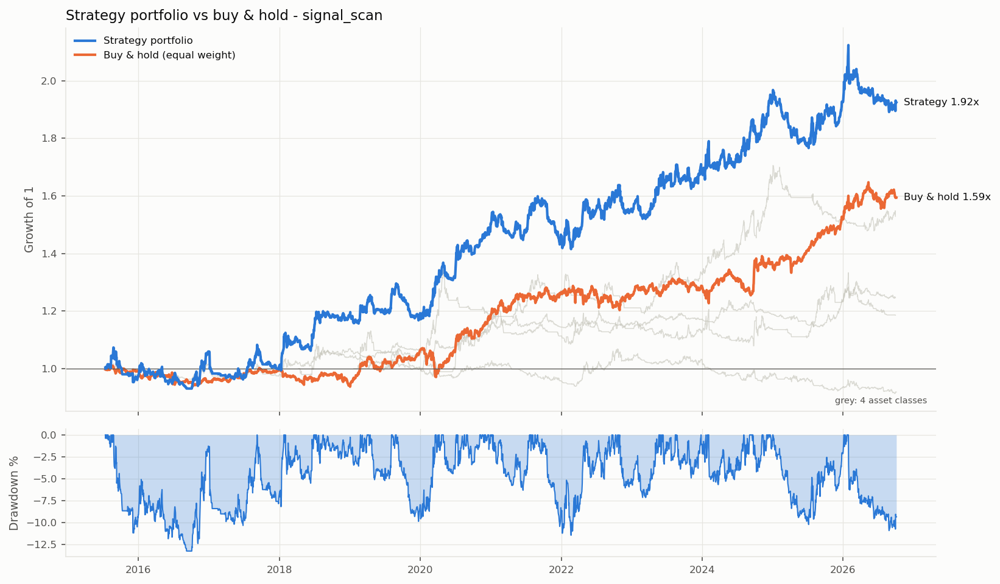
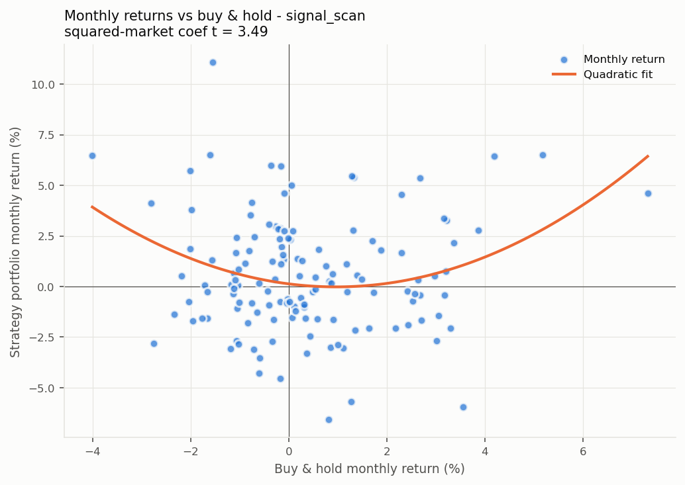
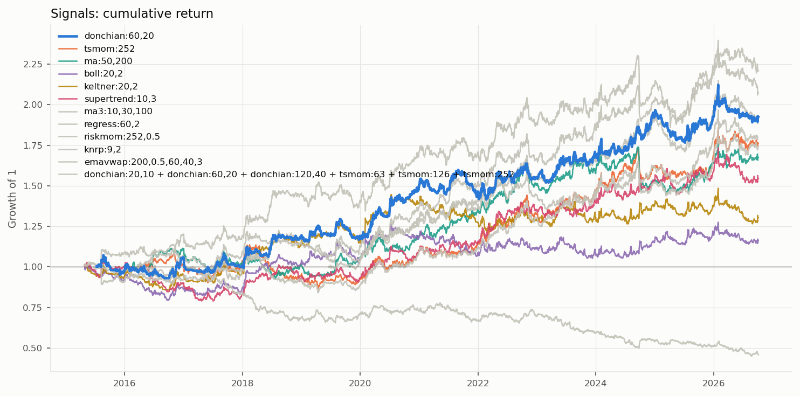
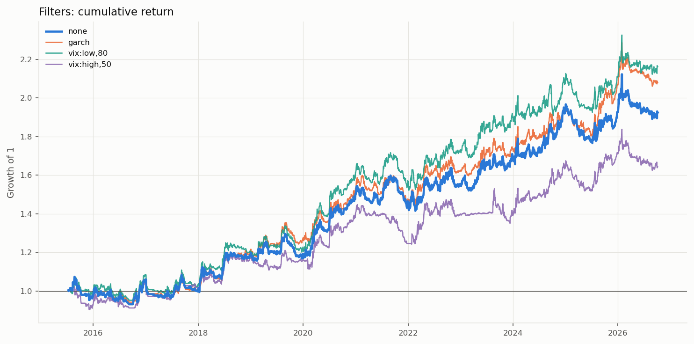
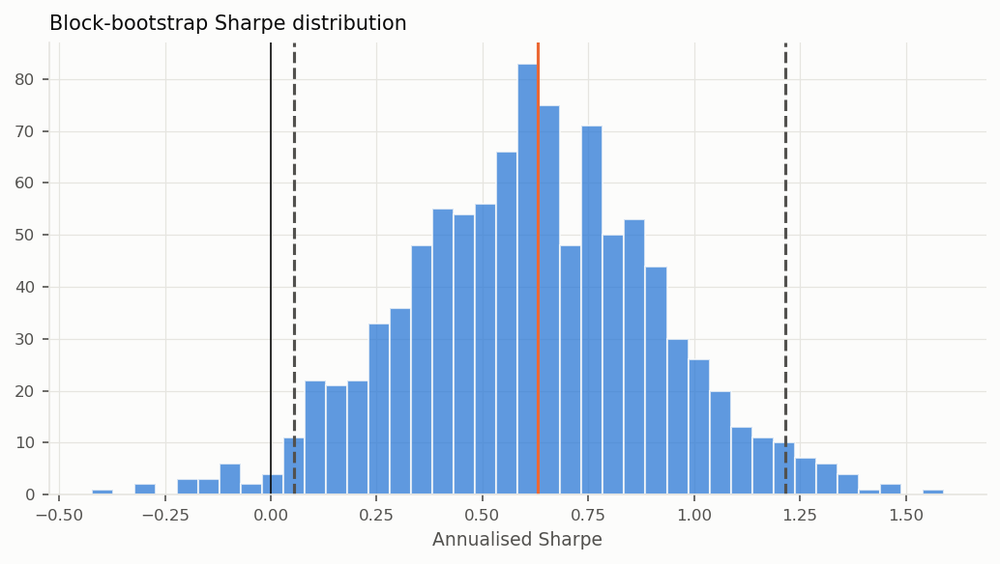

# 信号普查: 跨资产日线

> 生成时间: 2026-10-05 09:33 | 配置: `strategies/turtle/configs/signal_scan.toml`  
> **信号**: `donchian:60,20` | **过滤**: `none` | 周期: 1d | 起始: 2015-01-01  
> 组合: 各类别内等权, 再类别间等权 | 组合缩放到 10% 目标波动  
> 执行: 收盘价成交, 1% 风险/ATR 定仓位, 逐根盯市, 止损跳空按开盘价, 信号用复权价、盈亏用真实价格

| 市场 | 手续费 (单边) | 印花税 | 滑点 | 做空 | 每品种本金 |
|---|---:|---:|---:|---|---:|
| future | 1.0‱ | 0‱ | 1 跳 (最小变动价位) | 可以 | 10,000,000 |
| fx | 0.2‱ | 0‱ | 1.0‱ | 可以 | 1,000,000 |

按手收手续费的品种: T, TF, TL, TS; 其余期货按费率。

---

## 一、各品种表现

| 类别 | 品种 | 周期 | 起始 | 交易 | 年化% | 年化波动% | 夏普 | PF | 最大回撤% | Calmar | 持仓占比% |
|---|---|---|---|---:|---:|---:|---:|---:|---:|---:|---:|
| 股指 | IF | 1d | 2019-01-18 | 31 | +2.2 | 9.8 | 0.28 | 1.43 | -17.3 | 0.13 | 49 |
| 股指 | IH | 1d | 2019-01-18 | 26 | +0.6 | 9.8 | 0.11 | 1.11 | -23.1 | 0.02 | 48 |
| 股指 | IC | 1d | 2019-01-18 | 28 | +1.5 | 9.7 | 0.20 | 1.32 | -16.9 | 0.09 | 48 |
| 股指 | IM | 1d | 2022-10-26 | 12 | +4.9 | 9.8 | 0.54 | 3.42 | -11.7 | 0.42 | 52 |
| 国债 | T | 1d | 2019-02-15 | 26 | +4.4 | 9.0 | 0.52 | 1.84 | -18.8 | 0.23 | 53 |
| 国债 | TF | 1d | 2019-03-12 | 22 | +6.8 | 9.5 | 0.74 | 2.91 | -13.4 | 0.51 | 53 |
| 国债 | TS | 1d | 2019-04-22 | 23 | +4.9 | 8.8 | 0.59 | 2.35 | -14.1 | 0.35 | 51 |
| 国债 | TL | 1d | 2023-07-25 | 11 | +8.3 | 11.4 | 0.75 | 2.51 | -16.9 | 0.49 | 56 |
| 商品 | RB | 1d | 2018-08-13 | 33 | -1.6 | 8.7 | -0.15 | 0.71 | -22.8 | -0.07 | 49 |
| 商品 | I | 1d | 2018-08-02 | 32 | +1.9 | 9.0 | 0.25 | 1.29 | -28.0 | 0.07 | 48 |
| 商品 | CU | 1d | 2018-08-13 | 33 | +1.6 | 11.1 | 0.20 | 1.24 | -25.3 | 0.06 | 40 |
| 商品 | AL | 1d | 2018-08-13 | 31 | +1.4 | 10.6 | 0.19 | 1.26 | -25.6 | 0.06 | 47 |
| 商品 | AU | 1d | 2018-09-13 | 26 | +9.0 | 14.9 | 0.65 | 3.57 | -21.6 | 0.41 | 54 |
| 商品 | AG | 1d | 2018-08-13 | 33 | +4.8 | 17.8 | 0.35 | 1.85 | -35.8 | 0.14 | 42 |
| 商品 | SC | 1d | 2018-08-03 | 33 | +1.3 | 11.6 | 0.17 | 1.27 | -18.4 | 0.07 | 48 |
| 商品 | TA | 1d | 2018-08-13 | 29 | +4.9 | 11.6 | 0.47 | 2.21 | -15.8 | 0.31 | 53 |
| 商品 | MA | 1d | 2018-08-15 | 40 | -5.5 | 8.4 | -0.63 | 0.31 | -41.7 | -0.13 | 45 |
| 商品 | M | 1d | 2018-08-13 | 29 | +2.3 | 8.8 | 0.30 | 1.53 | -18.4 | 0.12 | 50 |
| 商品 | Y | 1d | 2018-08-13 | 28 | +2.5 | 8.4 | 0.33 | 1.51 | -19.8 | 0.12 | 48 |
| 商品 | CF | 1d | 2018-08-13 | 30 | +6.0 | 10.0 | 0.63 | 2.48 | -11.8 | 0.51 | 57 |
| 商品 | SR | 1d | 2018-04-09 | 39 | -4.4 | 7.4 | -0.57 | 0.41 | -36.3 | -0.12 | 41 |
| 汇率 | USDCNH | 1d | 2015-03-30 | 37 | +8.3 | 10.7 | 0.80 | 3.96 | -13.6 | 0.61 | 58 |
| 汇率 | EURUSD | 1d | 2015-03-30 | 54 | -3.2 | 6.9 | -0.43 | 0.52 | -37.6 | -0.08 | 43 |
| 汇率 | USDJPY | 1d | 2015-03-30 | 56 | -2.7 | 8.2 | -0.29 | 0.59 | -30.1 | -0.09 | 46 |
| 汇率 | AUDUSD | 1d | 2015-03-30 | 56 | -4.3 | 7.5 | -0.55 | 0.39 | -41.6 | -0.10 | 47 |
| 汇率 | GBPUSD | 1d | 2015-03-30 | 56 | -3.6 | 7.3 | -0.47 | 0.46 | -35.0 | -0.10 | 48 |

---

## 三、各资产类别 (类别内等权)

|  | 起始 | 年化收益% | 年化波动% | 夏普 | Sortino | 最大回撤% | Calmar | 成员数 |
|---|---|---:|---:|---:|---:|---:|---:|---:|
| 股指 | 2019-01-21 | +2.2 | 8.4 | 0.30 | 0.34 | -12.5 | 0.18 | 4 |
| 国债 | 2019-02-18 | +5.7 | 8.2 | 0.72 | 0.85 | -13.4 | 0.43 | 4 |
| 商品 | 2018-04-10 | +2.6 | 5.1 | 0.54 | 0.64 | -7.5 | 0.35 | 13 |
| 汇率 | 2015-03-31 | -1.0 | 5.0 | -0.18 | -0.22 | -15.0 | -0.07 | 5 |
| 组合 (全样本) | 2015-03-31 | +1.7 | 3.9 | 0.46 | 0.61 | -6.8 | 0.26 | 26 |
| 组合 (全部类别到齐后) | 2019-02-18 | +2.3 | 3.6 | 0.67 | 0.91 | -4.3 | 0.55 | 26 |

类别开始时间不同时, 早期的组合只由已有数据的类别构成, "全部类别到齐后"才是完整的跨资产组合。

类别之间的相关性 (策略日收益):

|  | 股指 | 国债 | 商品 | 汇率 |
|---|---:|---:|---:|---:|
| 股指 | 1.00 | -0.01 | 0.11 | 0.06 |
| 国债 | -0.01 | 1.00 | 0.01 | -0.01 |
| 商品 | 0.11 | 0.01 | 1.00 | 0.08 |
| 汇率 | 0.06 | -0.01 | 0.08 | 1.00 |

品种两两相关性平均: **类内 0.19**, **跨类 0.02** (对照 TSMOM 论文 Table 4)。

---

## 四、组合目标波动率 10%

|  | 起始 | 年化收益% | 年化波动% | 夏普 | Sortino | 最大回撤% | Calmar | 平均杠杆 | 最高杠杆 |
|---|---|---:|---:|---:|---:|---:|---:|---:|---:|
| 原始 | 2015-03-31 | +1.7 | 3.9 | 0.46 | 0.61 | -6.8 | 0.26 | 1.0 | 1.0 |
| 缩放后 | 2015-07-13 | +6.0 | 10.1 | 0.63 | 0.88 | -13.3 | 0.45 | 2.7 | 4.9 |

杠杆 = 目标波动 / 过去波动 (EWMA, 质心 60 天, 上限 10 倍), 只用过去数据。夏普基本不变, 收益和回撤同比例放大。以下各节使用缩放后的组合。

---

## 五、压力时期

| 时期 | 区间 | 策略组合% | 买入持有% | 当时有数据的类别 |
|---|---|---:|---:|---|
| 2015 股灾 | 2015-06-15 ~ 2015-09-15 | +2.0 | -0.5 | 汇率 |
| 2016 熔断 | 2016-01-01 ~ 2016-01-29 | +1.7 | -1.1 | 汇率 |
| 2018 贸易摩擦 | 2018-03-22 ~ 2018-12-31 | +8.2 | -3.1 | 商品, 汇率 |
| 2020 疫情冲击 | 2020-01-20 ~ 2020-03-23 | +11.1 | -9.0 | 股指, 国债, 商品, 汇率 |
| 2022 全球加息 | 2022-01-01 ~ 2022-10-31 | +12.1 | -4.9 | 股指, 国债, 商品, 汇率 |
| 2022 LUNA 崩盘 | 2022-05-05 ~ 2022-06-18 | -0.7 | +1.7 | 股指, 国债, 商品, 汇率 |
| 2022 FTX 破产 | 2022-11-06 ~ 2022-11-21 | -1.8 | +0.3 | 股指, 国债, 商品, 汇率 |
| 2024 年初小盘股下跌 | 2024-01-02 ~ 2024-02-05 | +5.8 | -4.6 | 股指, 国债, 商品, 汇率 |
| 2024-08 日元套息平仓 | 2024-07-31 ~ 2024-08-07 | +1.4 | -0.6 | 股指, 国债, 商品, 汇率 |
| 2025-04 关税冲击 | 2025-04-02 ~ 2025-04-09 | -2.1 | -3.1 | 股指, 国债, 商品, 汇率 |

日期为大致区间, 用来观察趋势策略在危机中的表现。

---

## 六、组合表现与风险特征

#### 组合表现 (donchian:60,20 | none; 4 个类别、26 个品种×周期, 2015-07-13 ~ 2026-10-05)

| 指标 | 策略组合 | 基准: 等权买入持有 |
|---|---:|---:|
| 年化收益 % | +6.0 | +4.2 |
| 年化波动 % | 10.1 | 6.4 |
| 夏普 | 0.63 | 0.68 |
| Sortino | 0.88 | 0.89 |
| 最大回撤 % | -13.3 | -9.4 |
| Calmar | 0.45 | 0.45 |

跨类别品种两两相关性平均: 0.02  (越低, 分散化降波动的效果越好)

| 年份 | 策略组合 | 等权持有 |
|---|---:|---:|
| 2015 | -2.5% | -1.1% |
| 2016 | +7.9% | -3.3% |
| 2017 | -4.4% | +4.2% |
| 2018 | +17.9% | -5.5% |
| 2019 | +0.5% | +12.9% |
| 2020 | +26.1% | +11.6% |
| 2021 | -2.9% | +6.6% |
| 2022 | +6.5% | -0.7% |
| 2023 | +8.7% | +2.5% |
| 2024 | +14.7% | +5.8% |
| 2025 | -0.6% | +11.5% |
| 2026 | -0.1% | +5.0% |

#### 风险特征 (月度回归, 括号内为 Newey-West t 值)

| 回归 | α (月) | 基准收益 | 基准收益² | 基准波动率 | 高波动哑变量 | R² |
|---|---:|---:|---:|---:|---:|---:|
| CAPM | 0.52% (2.45) | 0.019 (0.10) | | | | 0.00 |
| Smile | | -0.309 (-1.60) | 15.976 (3.49) | | | 0.08 |
| 波动率状态 | | | | 0.291 (2.06) | -0.79% (-0.84) | 0.04 |

样本 136 个月。读法:
- **CAPM α**: 月均 0.52% (年化约 6.2%), t = 2.45。显著, 扣除被动做多后仍有超额收益。
- **Smile**: 基准收益平方项 t = 3.49。显著为正: 大涨大跌时都赚钱, 类似 TSMOM 的 smile。
- **波动率状态**: 基准波动率 t = 2.06, 高波动哑变量 t = -0.84。策略收益与市场波动率状态有关。
- CAPM 的截距是 α (基准是可交易的等权持有组合); Smile 和波动率回归的截距没有 α 含义, 不报告。
- 高波动阈值用全样本 80% 分位数, 是描述性分析, 不能直接当交易规则。

---

## 七、稳定性检验

样本内 / 样本外分界: **2022-01-01** (样本内挑参数, 样本外检验)。

### 7.1 换信号

| signal | 年化收益% | 年化波动% | 夏普 | 最大回撤% | Calmar | 样本内夏普 | 样本外夏普 | 交易次数 | 夏普·股指 | 夏普·国债 | 夏普·商品 | 夏普·汇率 |
|---|---:|---:|---:|---:|---:|---:|---:|---:|---:|---:|---:|---:|
| donchian:60,20 | +6.0 | 10.1 | 0.63 | -13.3 | 0.45 | 0.64 | 0.61 | 854 | 0.30 | 0.72 | 0.54 | -0.18 |
| tsmom:252 | +5.5 | 10.1 | 0.58 | -23.7 | 0.23 | 0.29 | 0.93 | 1286 | 0.21 | 0.60 | 0.33 | 0.25 |
| ma:50,200 | +4.9 | 10.1 | 0.53 | -17.1 | 0.29 | 0.56 | 0.49 | 313 | 0.18 | 0.76 | 0.30 | -0.11 |
| boll:20,2 | +1.3 | 10.2 | 0.18 | -21.4 | 0.06 | 0.17 | 0.19 | 1904 | 0.04 | -0.03 | 0.72 | -0.18 |
| keltner:20,2 | +2.4 | 10.2 | 0.28 | -16.0 | 0.15 | 0.41 | 0.10 | 1278 | 0.04 | 0.15 | 0.65 | -0.19 |
| supertrend:10,3 | +3.9 | 10.3 | 0.42 | -24.5 | 0.16 | 0.26 | 0.64 | 1449 | 0.28 | 0.10 | 0.74 | 0.09 |
| ma3:10,30,100 | +7.4 | 9.9 | 0.77 | -12.2 | 0.60 | 0.73 | 0.82 | 1265 | 0.21 | 0.79 | 0.69 | 0.28 |
| regress:60,2 | +6.7 | 10.4 | 0.67 | -19.3 | 0.35 | 0.83 | 0.45 | 802 | -0.15 | 0.82 | 0.82 | 0.16 |
| riskmom:252,0.5 | +5.4 | 10.1 | 0.57 | -26.2 | 0.21 | 0.24 | 0.95 | 251 | 0.28 | 0.61 | 0.49 | 0.12 |
| knrp:9,2 | -6.6 | 10.3 | -0.61 | -56.3 | -0.12 | -0.53 | -0.73 | 20057 | -0.08 | -0.21 | -0.72 | -0.28 |
| emavwap:200,0.5,60,40,3 | +8.3 | 10.1 | 0.84 | -14.5 | 0.57 | 1.44 | 0.51 | 483 | 0.11 | 0.62 | 0.41 | — |
| donchian:20,10 + donchian:60,20 + donchian:120,40 + tsmom:63 + tsmom:126 + tsmom:252 | +6.3 | 10.1 | 0.65 | -16.1 | 0.39 | 0.61 | 0.71 | 9317 | 0.19 | 0.73 | 0.34 | 0.14 |

日收益相关性 (越低, 组合在一起越有分散效果):

|  | donchian:60,20 | tsmom:252 | ma:50,200 | boll:20,2 | keltner:20,2 | supertrend:10,3 | ma3:10,30,100 | regress:60,2 | riskmom:252,0.5 | knrp:9,2 | emavwap:200,0.5,60,40,3 | donchian:20,10 + donchian:60,20 + donchian:120,40 + tsmom:63 + tsmom:126 + tsmom:252 |
|---|---:|---:|---:|---:|---:|---:|---:|---:|---:|---:|---:|---:|
| donchian:60,20 | 1.00 | 0.48 | 0.50 | 0.69 | 0.76 | 0.65 | 0.83 | 0.73 | 0.45 | -0.02 | 0.74 | 0.87 |
| tsmom:252 | 0.48 | 1.00 | 0.72 | 0.23 | 0.27 | 0.21 | 0.49 | 0.50 | 0.95 | -0.04 | 0.74 | 0.69 |
| ma:50,200 | 0.50 | 0.72 | 1.00 | 0.15 | 0.20 | 0.14 | 0.56 | 0.57 | 0.74 | -0.08 | 0.69 | 0.68 |
| boll:20,2 | 0.69 | 0.23 | 0.15 | 1.00 | 0.90 | 0.76 | 0.55 | 0.30 | 0.19 | 0.01 | 0.47 | 0.62 |
| keltner:20,2 | 0.76 | 0.27 | 0.20 | 0.90 | 1.00 | 0.76 | 0.58 | 0.39 | 0.22 | 0.00 | 0.51 | 0.66 |
| supertrend:10,3 | 0.65 | 0.21 | 0.14 | 0.76 | 0.76 | 1.00 | 0.61 | 0.44 | 0.16 | -0.07 | 0.45 | 0.60 |
| ma3:10,30,100 | 0.83 | 0.49 | 0.56 | 0.55 | 0.58 | 0.61 | 1.00 | 0.79 | 0.48 | -0.07 | 0.70 | 0.80 |
| regress:60,2 | 0.73 | 0.50 | 0.57 | 0.30 | 0.39 | 0.44 | 0.79 | 1.00 | 0.50 | -0.13 | 0.64 | 0.72 |
| riskmom:252,0.5 | 0.45 | 0.95 | 0.74 | 0.19 | 0.22 | 0.16 | 0.48 | 0.50 | 1.00 | -0.08 | 0.74 | 0.64 |
| knrp:9,2 | -0.02 | -0.04 | -0.08 | 0.01 | 0.00 | -0.07 | -0.07 | -0.13 | -0.08 | 1.00 | -0.03 | -0.02 |
| emavwap:200,0.5,60,40,3 | 0.74 | 0.74 | 0.69 | 0.47 | 0.51 | 0.45 | 0.70 | 0.64 | 0.74 | -0.03 | 1.00 | 0.83 |
| donchian:20,10 + donchian:60,20 + donchian:120,40 + tsmom:63 + tsmom:126 + tsmom:252 | 0.87 | 0.69 | 0.68 | 0.62 | 0.66 | 0.60 | 0.80 | 0.72 | 0.64 | -0.02 | 0.83 | 1.00 |

### 7.2 换过滤器

| filter | 年化收益% | 年化波动% | 夏普 | 最大回撤% | Calmar | 样本内夏普 | 样本外夏普 | 交易次数 | 夏普·股指 | 夏普·国债 | 夏普·商品 | 夏普·汇率 | 被挡掉的入场 |
|---|---:|---:|---:|---:|---:|---:|---:|---:|---:|---:|---:|---:|---:|
| none | +6.0 | 10.1 | 0.63 | -13.3 | 0.45 | 0.64 | 0.61 | 854 | 0.30 | 0.72 | 0.54 | -0.18 | 0 |
| garch | +6.7 | 10.0 | 0.70 | -13.1 | 0.52 | 0.66 | 0.76 | 610 | 0.36 | 0.49 | 0.63 | 0.12 | 980 |
| vix:low,80 | +7.1 | 10.1 | 0.74 | -11.4 | 0.63 | 0.76 | 0.71 | 738 | 0.34 | 0.82 | 0.53 | -0.12 | 406 |
| vix:high,50 | +4.6 | 9.9 | 0.50 | -14.2 | 0.32 | 0.41 | 0.61 | 551 | 0.21 | 0.24 | 0.55 | 0.19 | 1294 |

日收益相关性 (越低, 组合在一起越有分散效果):

|  | none | garch | vix:low,80 | vix:high,50 |
|---|---:|---:|---:|---:|
| none | 1.00 | 0.95 | 0.96 | 0.84 |
| garch | 0.95 | 1.00 | 0.90 | 0.84 |
| vix:low,80 | 0.96 | 0.90 | 1.00 | 0.77 |
| vix:high,50 | 0.84 | 0.84 | 0.77 | 1.00 |

过滤器只是挡掉部分入场, 如果"被挡掉的入场"很多而夏普没提高, 说明它挡掉的并不是坏交易。

### 7.3 信号 × 过滤器组合普查 (136 个组合)

**样本内夏普** (行 = 信号, 列 = 过滤器):

| 信号 | none | garch | vix:low,80 | vix:high,50 |
|---|---:|---:|---:|---:|
| donchian:20,10 | 0.33 | 0.66 | 0.31 | 0.26 |
| donchian:60,20 | 0.64 | 0.66 | 0.76 | 0.41 |
| donchian:120,40 | 0.37 | 0.29 | 0.48 | 0.12 |
| tsmom:63 | 0.68 | 0.64 | 0.64 | 0.77 |
| tsmom:126 | 0.79 | 0.85 | 0.88 | 0.83 |
| tsmom:252 | 0.29 | 0.21 | 0.29 | 0.40 |
| ma:20,60 | 0.52 | 0.66 | 0.54 | 0.72 |
| ma:50,200 | 0.56 | 0.53 | 0.52 | 0.55 |
| ma:100,250 | 0.24 | 0.20 | 0.24 | 0.14 |
| boll:20,2 | 0.17 | 0.32 | 0.15 | 0.01 |
| boll:60,2 | 0.65 | 0.64 | 0.72 | 0.51 |
| boll:120,2 | 0.55 | 0.46 | 0.65 | 0.35 |
| keltner:20,2 | 0.41 | 0.52 | 0.38 | 0.42 |
| keltner:60,2 | 0.38 | 0.48 | 0.46 | 0.38 |
| keltner:120,2 | 0.36 | 0.35 | 0.40 | 0.27 |
| supertrend:10,3 | 0.26 | 0.26 | 0.23 | 0.39 |
| supertrend:20,3 | 0.06 | 0.08 | 0.06 | 0.08 |
| supertrend:50,3 | -0.00 | 0.11 | -0.01 | 0.01 |
| ma3:5,20,60 | 0.67 | 0.79 | 0.70 | 0.72 |
| ma3:10,30,100 | 0.73 | 0.68 | 0.79 | 0.51 |
| ma3:20,60,200 | 0.60 | 0.65 | 0.59 | 0.70 |
| regress:20,2 | 0.31 | 0.48 | 0.39 | 0.17 |
| regress:60,2 | 0.83 | 0.82 | 0.78 | 0.99 |
| regress:120,2 | 0.38 | 0.31 | 0.39 | 0.47 |
| riskmom:63,0.5 | 0.60 | 0.53 | 0.63 | 0.46 |
| riskmom:126,0.5 | 0.74 | 0.68 | 0.78 | 0.67 |
| riskmom:252,0.5 | 0.24 | 0.27 | 0.26 | 0.22 |
| knrp:9,2 | -0.53 | -0.75 | -0.57 | -0.25 |
| knrp:20,5 | -0.64 | -0.62 | -0.73 | -0.07 |
| knrp:50,10 | -0.31 | 0.00 | -0.20 | -0.38 |
| emavwap:50,0.5,60,40,3 | 0.68 | 0.47 | 0.74 | 0.36 |
| emavwap:100,0.5,60,40,3 | 1.10 | 0.75 | 1.16 | 0.68 |
| emavwap:200,0.5,60,40,3 | 1.44 | 1.22 | 1.50 | 0.56 |
| donchian:20,10 + donchian:60,20 + donchian:120,40 + tsmom:63 + tsmom:126 + tsmom:252 | 0.61 | 0.66 | 0.65 | 0.71 |

**样本外夏普** (行 = 信号, 列 = 过滤器):

| 信号 | none | garch | vix:low,80 | vix:high,50 |
|---|---:|---:|---:|---:|
| donchian:20,10 | 0.28 | 0.44 | 0.38 | 0.30 |
| donchian:60,20 | 0.61 | 0.76 | 0.71 | 0.61 |
| donchian:120,40 | 0.87 | 0.75 | 1.04 | 0.84 |
| tsmom:63 | 0.50 | 0.66 | 0.55 | 0.32 |
| tsmom:126 | 0.63 | 0.73 | 0.66 | 0.68 |
| tsmom:252 | 0.93 | 1.01 | 0.95 | 1.01 |
| ma:20,60 | 0.42 | 0.42 | 0.39 | 0.33 |
| ma:50,200 | 0.49 | 0.62 | 0.51 | 0.60 |
| ma:100,250 | 1.04 | 1.08 | 1.06 | 0.91 |
| boll:20,2 | 0.19 | 0.12 | 0.34 | 0.19 |
| boll:60,2 | 0.63 | 0.52 | 0.57 | 0.45 |
| boll:120,2 | 0.88 | 0.85 | 0.99 | 0.82 |
| keltner:20,2 | 0.10 | 0.24 | 0.21 | 0.16 |
| keltner:60,2 | 0.50 | 0.53 | 0.51 | 0.30 |
| keltner:120,2 | 0.62 | 0.63 | 0.75 | 0.60 |
| supertrend:10,3 | 0.64 | 0.45 | 0.73 | 0.51 |
| supertrend:20,3 | 0.70 | 0.53 | 0.77 | 0.49 |
| supertrend:50,3 | 0.27 | 0.18 | 0.31 | 0.10 |
| ma3:5,20,60 | 0.78 | 0.80 | 0.80 | 0.15 |
| ma3:10,30,100 | 0.82 | 0.83 | 0.78 | 0.34 |
| ma3:20,60,200 | 0.49 | 0.59 | 0.45 | 0.53 |
| regress:20,2 | 0.81 | 0.42 | 0.86 | -0.09 |
| regress:60,2 | 0.45 | 0.35 | 0.46 | 0.22 |
| regress:120,2 | 0.49 | 0.46 | 0.48 | 0.46 |
| riskmom:63,0.5 | 0.52 | 0.56 | 0.56 | 0.34 |
| riskmom:126,0.5 | 0.72 | 0.69 | 0.71 | 0.68 |
| riskmom:252,0.5 | 0.95 | 0.94 | 1.01 | 0.96 |
| knrp:9,2 | -0.73 | -0.41 | -0.47 | -0.29 |
| knrp:20,5 | -0.36 | -0.17 | -0.26 | 0.35 |
| knrp:50,10 | -0.06 | -0.13 | 0.03 | 0.34 |
| emavwap:50,0.5,60,40,3 | 0.60 | 0.53 | 0.56 | 0.34 |
| emavwap:100,0.5,60,40,3 | 0.57 | 0.57 | 0.64 | 0.41 |
| emavwap:200,0.5,60,40,3 | 0.51 | 0.58 | 0.56 | 0.47 |
| donchian:20,10 + donchian:60,20 + donchian:120,40 + tsmom:63 + tsmom:126 + tsmom:252 | 0.71 | 0.80 | 0.80 | 0.75 |

按样本内夏普挑出的前 5 个组合:

| 信号 | 过滤器 | 夏普 | 样本内夏普 | 样本外夏普 | 最大回撤% | 交易次数 | 最差时期夏普 | 盈利时期占比% |
|---|---|---:|---:|---:|---:|---:|---:|---:|
| emavwap:200,0.5,60,40,3 | vix:low,80 | 0.88 | 1.50 | 0.56 | -14.9 | 436 | 0.14 | 100 |
| emavwap:200,0.5,60,40,3 | none | 0.84 | 1.44 | 0.51 | -14.5 | 483 | 0.11 | 100 |
| emavwap:200,0.5,60,40,3 | garch | 0.80 | 1.22 | 0.58 | -16.5 | 337 | -0.12 | 75 |
| emavwap:100,0.5,60,40,3 | vix:low,80 | 0.83 | 1.16 | 0.64 | -9.8 | 503 | 0.09 | 100 |
| emavwap:100,0.5,60,40,3 | none | 0.76 | 1.10 | 0.57 | -10.5 | 558 | 0.03 | 100 |

- 前 5 个组合: 样本内平均夏普 **1.28** → 样本外平均 **0.57**; 全部组合样本外夏普中位数 0.54
- 读法: 试了这么多组合, 样本内最好的几个大概率有运气成分. 只有样本外仍明显高于中位数的组合才值得留下; 如果前 5 名到样本外跌回中位数附近, 说明"挑组合"本身没有带来真实的提升。

**按信号类型汇总** (每类包含它的全部窗口 × 全部过滤器; 看中位数, 不看最好的那个):

| 类型 | 组合数 | 夏普中位数 | 样本外夏普中位数 | 最好样本外夏普 | 最差时期夏普中位数 | 盈利时期占比中位数 |
|---|---:|---:|---:|---:|---:|---:|
| 混合 | 4 | 0.72 | 0.77 | 0.80 | 0.02 | 90 |
| riskmom | 12 | 0.59 | 0.70 | 1.01 | 0.07 | 100 |
| ma3 | 12 | 0.67 | 0.68 | 0.83 | 0.12 | 100 |
| tsmom | 12 | 0.63 | 0.67 | 1.01 | -0.05 | 80 |
| donchian | 12 | 0.53 | 0.66 | 1.04 | -0.25 | 80 |
| emavwap | 12 | 0.63 | 0.56 | 0.64 | -0.05 | 88 |
| ma | 12 | 0.56 | 0.55 | 1.08 | 0.10 | 100 |
| boll | 12 | 0.58 | 0.54 | 0.99 | -0.45 | 80 |
| keltner | 12 | 0.42 | 0.50 | 0.75 | -0.14 | 80 |
| supertrend | 12 | 0.30 | 0.50 | 0.77 | -0.80 | 80 |
| regress | 12 | 0.49 | 0.46 | 0.86 | -0.48 | 80 |
| knrp | 12 | -0.35 | -0.22 | 0.35 | -0.73 | 20 |

**分时期夏普** (全样本夏普前 15 名; 全部 136 个组合见 `signal_scan_combos.csv`):

| 信号 | 过滤器 | 夏普 | 夏普 至2017 | 夏普 2018-19 | 夏普 2020-21 | 夏普 2022-23 | 夏普 2024-26 | 夏普 至2019 | 最差时期夏普 | 盈利时期占比% |
|---|---|---:|---:|---:|---:|---:|---:|---:|---:|---:|
| emavwap:200,0.5,60,40,3 | vix:low,80 | 0.88 | — | — | 1.60 | 0.14 | 0.87 | 1.06 | 0.14 | 100 |
| emavwap:200,0.5,60,40,3 | none | 0.84 | — | — | 1.55 | 0.11 | 0.80 | 0.95 | 0.11 | 100 |
| emavwap:100,0.5,60,40,3 | vix:low,80 | 0.83 | — | — | 1.46 | 0.09 | 1.04 | 0.19 | 0.09 | 100 |
| emavwap:200,0.5,60,40,3 | garch | 0.80 | — | — | 1.46 | 0.05 | 0.97 | -0.12 | -0.12 | 75 |
| boll:120,2 | vix:low,80 | 0.80 | 0.50 | -0.53 | 1.77 | 0.93 | 1.04 | — | -0.53 | 80 |
| tsmom:126 | garch | 0.80 | 0.97 | -0.06 | 1.56 | 1.00 | 0.54 | — | -0.06 | 80 |
| ma3:5,20,60 | garch | 0.79 | 0.23 | 1.14 | 1.31 | 1.19 | 0.50 | — | 0.23 | 100 |
| ma3:10,30,100 | vix:low,80 | 0.79 | 0.12 | 0.68 | 1.57 | 1.02 | 0.61 | — | 0.12 | 100 |
| tsmom:126 | vix:low,80 | 0.78 | 1.00 | 0.12 | 1.44 | 1.13 | 0.32 | — | 0.12 | 100 |
| ma3:10,30,100 | none | 0.77 | 0.05 | 0.70 | 1.47 | 0.99 | 0.69 | — | 0.05 | 100 |
| tsmom:126 | vix:high,50 | 0.77 | 1.12 | -0.27 | 1.44 | 1.04 | 0.42 | — | -0.27 | 80 |
| emavwap:100,0.5,60,40,3 | none | 0.76 | — | — | 1.45 | 0.08 | 0.91 | 0.03 | 0.03 | 100 |
| riskmom:126,0.5 | vix:low,80 | 0.75 | 0.87 | 0.16 | 1.25 | 1.07 | 0.45 | — | 0.16 | 100 |
| ma3:10,30,100 | garch | 0.74 | 0.11 | 0.69 | 1.22 | 0.81 | 0.84 | — | 0.11 | 100 |
| ma3:5,20,60 | vix:low,80 | 0.74 | 0.13 | 0.73 | 1.55 | 1.19 | 0.51 | — | 0.13 | 100 |

- 读法: 只在某一段时期赚钱、其他时期为负的组合, 本质上是押中了那段行情; 各时期都为正 (盈利时期占比高、最差时期夏普不太负) 的才是稳定的。

### 7.4 分年度

| 年份 | 收益% | 夏普 | 最大回撤% |
|---|---:|---:|---:|
| 2015 | -2.5 | -0.40 | -11.2 |
| 2016 | +7.9 | 0.77 | -8.6 |
| 2017 | -4.4 | -0.48 | -9.2 |
| 2018 | +17.9 | 1.67 | -5.5 |
| 2019 | +0.5 | 0.10 | -9.9 |
| 2020 | +26.1 | 2.10 | -4.4 |
| 2021 | -2.9 | -0.30 | -10.5 |
| 2022 | +6.5 | 0.61 | -6.6 |
| 2023 | +8.7 | 0.92 | -4.9 |
| 2024 | +14.7 | 1.29 | -5.7 |
| 2025 | -0.6 | -0.02 | -10.2 |
| 2026 | -0.1 | 0.03 | -10.9 |

赚钱的年份: 7 / 12。

### 7.5 自助法夏普置信区间

按 20 天分块有放回重抽组合日收益 1000 次 (保留波动聚集和短期自相关):

- 夏普 **0.63**, 95% 区间 **[0.05, 1.21]**
- 重抽样本中夏普 ≤ 0 的比例: **1.7%** (区间不含 0, 收益不太可能纯属运气)
- 注意: 这只衡量样本内的抽样误差, 不能纠正"试了很多策略挑最好的"带来的偏差。

### 7.6 成本敏感性 (滑点倍数)

| 滑点倍数 | 年化收益% | 年化波动% | 夏普 | 最大回撤% | Calmar |
|---|---:|---:|---:|---:|---:|
| ×0 | +6.3 | 10.1 | 0.66 | -13.1 | 0.48 |
| ×1 | +6.0 | 10.1 | 0.63 | -13.3 | 0.45 |
| ×2 | +5.7 | 10.1 | 0.60 | -13.5 | 0.42 |
| ×4 | +4.5 | 10.1 | 0.49 | -15.3 | 0.30 |

滑点翻倍后夏普还剩多少, 决定了策略在真实交易中能不能活下来。
